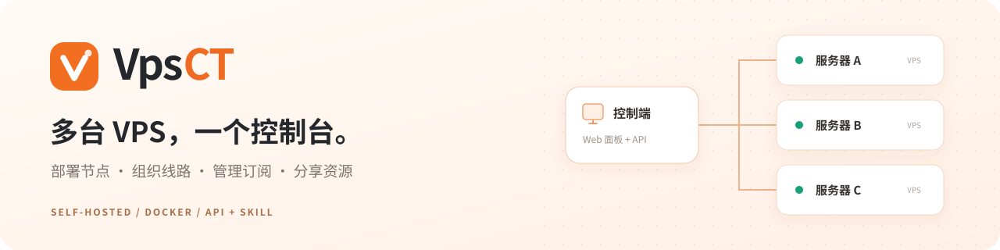
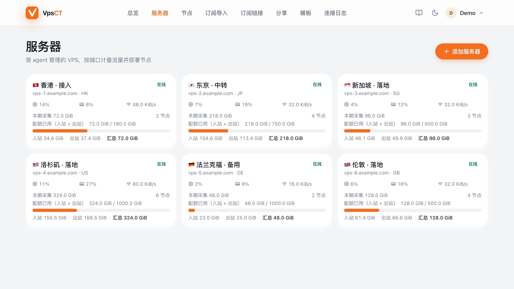

<p align="center">
  
</p>

<p align="center">
  <strong>面向个人与小团队的自托管 VPS 管理面板</strong><br>
  部署代理节点、组织转发线路、生成订阅，按配额分享资源。网页与 AI agent 共用同一套业务能力。
</p>

<p align="center">
  <a href="LICENSE"></a>
  <a href="docs/operations.md#32-docker-新安装"></a>
  <a href="docs/agent-api.md"></a>
  <a href="CONTRIBUTING.md"></a>
</p>

<p align="center">
  <a href="#3-快速开始"><strong>快速开始</strong></a> ·
  <a href="#4-按需要组织线路">线路与出口</a> ·
  <a href="#5-让-ai-agent-接手操作">AI 接入</a> ·
  <a href="#7-文档与贡献">文档索引</a> ·
  <a href="https://github.com/YongshengWin/VpsCT/releases">版本发布</a>
</p>

## 1. 先看看面板

[](docs/assets/servers-demo.jpg)

<p align="center"><sub>实际产品界面 · 点击查看 4K 原图 · 使用虚构演示数据，不包含真实服务器或凭据</sub></p>

一眼查看各台 VPS 的在线状态、资源占用、网络速率和本期用量。进入服务器详情，即可管理节点、线路、网卡、诊断与配置版本。

## 2. 你可以用它做什么

| 服务器与节点 | 线路与出口 |
| --- | --- |
| 集中管理多台 VPS，查看 CPU、内存、磁盘、速率与运行诊断。<br>通过 agent 部署节点、下发配置，核对实际应用结果。 | 选择入口、中转和落地节点，创建两台或三台线路。<br>为已有节点更换出口，也可单独配置端口转发。 |
| **订阅与模板** | **分享与配额** |
| 整理受管、导入和手动节点，生成多种客户端格式。<br>用模板管理 DNS、代理组与分流，按需要组合订阅。 | 为不同使用者分配独立凭据、配额与有效期。<br>查看各份分享用量，按需暂停、恢复、撤销或重新签发。 |
| **流量与运维** | **AI 与自动化** |
| 区分入站和出站，选择配额公式、重置日与计费网卡。<br>查看配置回执、执行记录，完成升级、备份与恢复。 | API key、OpenAPI、Python 客户端与可下载 Skill。<br>发现当前权限，按操作流程执行，再查询任务结果。 |

> 本页介绍当前源码能力；正式发行附件以 [Releases](https://github.com/YongshengWin/VpsCT/releases) 为准。新功能需配套版本的控制端与 agent，具体系统、协议和内核要求见对应文档。

## 3. 快速开始

一台**控制端**运行面板；每台受管 VPS 安装 **ctlvps-agent**。agent 主动连接控制端，接收配置并上报状态，无需额外开放管理端口。

### 3.1 安装面板

面板需要 Safari 16.4+、Chrome 111+ 或 Firefox 128+。

当前发行版仅支持 **Linux AMD64（x86_64）**，包括控制端、Docker 和被控 agent。ARM 支持暂停，待具备真实测试机器并完成验证后再恢复；历史 ARM Release 附件已撤下。

**原生安装**适用于 Debian / Ubuntu、systemd、Linux amd64。准备已解析的面板域名，并确保 80、443 端口可用：

```bash
curl -fLsS --proto '=https' --proto-redir '=https' \
  https://github.com/YongshengWin/VpsCT/releases/latest/download/install.sh \
  -o install-vpsct.sh &&
sudo bash install-vpsct.sh --domain panel.example.com
```

替换 `panel.example.com`。安装器下载并校验程序，配置 systemd 和 Caddy HTTPS，无需在服务器安装 Go 或 Node。

<details>
<summary><strong>使用 Docker Compose 安装</strong></summary>

需要本机 Docker Engine 和 Compose v2；Alpine/OpenRC 宿主机也可使用。以下从源码构建：

```bash
git clone https://github.com/YongshengWin/VpsCT.git
cd VpsCT/deploy
printf 'CTLVPS_SITE_URL=https://panel.example.com\n' > .env
docker compose up -d --build
```

替换 `.env` 中的面板域名。默认仅映射 `127.0.0.1:8080`，需配置宿主机 HTTPS 反向代理；`/data`、`/keys` 使用独立持久化卷。镜像在本机构建，不依赖未发布的公共镜像。

查看初始化令牌：

```bash
docker compose exec -T ctlvpsd cat /data/setup-token
```

部署、健康检查和已有数据处理见 [Docker 部署说明](docs/operations.md#32-docker-新安装)。

</details>

<details>
<summary><strong>已有 HTTPS 入口或需要其他端口</strong></summary>

将已有入口反向代理到本机 `127.0.0.1:8080`，再使用安装器的 `--site-url` 与 `--no-proxy`：

```bash
sudo bash install-vpsct.sh --site-url https://panel.example.com:8443 --no-proxy
```

标准 HTTPS 端口可去掉 `:8443`。开启 Cloudflare 橙云时使用 **Full (strict) / 完全（严格）**，避免 Flexible 与 HTTPS 跳转形成循环。详见 [HTTPS 与 Cloudflare 排查](docs/operations.md#26-cloudflare-设置与访问排查)。

</details>

原生安装完成后，在控制端读取一次性初始化令牌：

```bash
sudo cat /opt/ctlvps/data/setup-token
```

通过面板的 HTTPS 域名访问，输入令牌并创建管理员。初始化后令牌失效。完整安装步骤见 [安装、升级与恢复](docs/operations.md)。

### 3.2 接入服务器

1. 打开「服务器 → 添加服务器」，填写名称、地址和配额。
2. 在服务器详情生成 agent 安装命令。
3. 到**对应受管 VPS** 上，以 root 执行该命令。
4. 返回面板，确认服务器「在线」，再部署所需节点。

受管端支持 systemd，以及受支持的 Alpine/OpenRC 环境。代理服务端口仍需按配置开放；NAT 主机先配置商家端口映射。详见 [Alpine 与小内存主机](docs/operations.md#49-alpineopenrc-与小内存-vps)、[NAT 端口映射](docs/operations.md#48-nat-vps-的端口映射)。

### 3.3 生成第一份订阅

在服务器详情部署节点，等待配置实际应用；打开「订阅链接」，选择节点和客户端格式，生成订阅。需要统一 DNS、代理组和分流时，先在「模板」中准备底稿。

登录后，点击右上角主题切换旁的**书本图标**进入内置使用手册：左侧按章节浏览，右侧定位当前小节，也可全文搜索。

## 4. 按需要组织线路

| 你的需求 | 在面板中如何操作 | 访问路径 |
| --- | --- | --- |
| 通过入口与中转接入落地 | 节点线路 → 转发线路；默认三台，可切换两台 | 入口 → 中转 → 落地节点 → 网站 |
| 第 2 台同时承担落地 | 转发线路选择两台结构 | 入口 → 落地节点 → 网站 |
| 已有 VLESS 等节点想换出口 | 节点线路 → 节点出口 | 原节点 → 所选出口 → 网站 |
| 单独转发一个端口 | 节点线路 → 单段转发 | 本机端口 → 指定目标 |

落地可选择受管、导入或手动节点，实际支持取决于节点传输方式和主机能力；入口与中转无需重复部署代理节点。机器间的网络与路由需预先接通，创建转发规则不会自动建立物理专线。

查看 [网络与中转指南](docs/network.md)、[UDP 转发能力与限制](docs/udp-forwarding-validation.md)。

## 5. 让 AI agent 接手操作

打开「头像菜单 → AI 能力」，创建适当权限的 API key，并安装同版本 VpsCT Skill。支持页面提供的 Codex / Claude Code 安装方式，也可使用标准 HTTP 客户端。

- **先发现**：查询实时能力、账户权限和 OpenAPI，请求字段以当前部署版本为准。
- **再执行**：15 条主要操作流程覆盖接入、部署、线路、出口、订阅、分享、监控和维护。
- **查结果**：按资源或任务编号核对进展、失败原因与完成状态，保存成功不等于配置已应用。

你可以这样描述任务：

> “用指定入口和中转，连接我选中的落地节点。先预览影响，创建后确认线路已应用，再交付订阅。”

原生与 Docker 的部署、升级和恢复也有配套指引。主机操作需要目标授权，API key 继承账户角色，初始化与二次认证要求保持有效。

[AI 接口与接入说明](docs/agent-api.md) · [VpsCT Skill](skills/vpsct/SKILL.md) · [请求与部署示例](skills/vpsct/references/api.md)

## 6. 日常运维

| 操作 | 入口与说明 |
| --- | --- |
| 看用量、校准账期 | 服务器详情 → 节点与概览；支持双向、仅入站、仅出站或两方向较大值，[公式与边界](docs/traffic-accounting.md) |
| 管理访问与分享 | 分享页面管理凭据、配额和有效期；[订阅与分享说明](docs/subscriptions.md) |
| 更新控制端与 agent | 原生安装使用安装器或受支持的网页维护；Docker 使用宿主机 Compose 脚本，[升级流程](docs/operations.md#5-更新) |
| 备份与恢复 | 数据库、密钥与配置配套保存；回退需匹配的数据快照，[备份说明](docs/operations.md#43-备份数据) |
| 卸载与清理 | 先确认控制端 / agent 和保留范围，默认保留数据，[卸载说明](docs/operations.md#7-卸载与清理) |

<details>
<summary><strong>常用升级命令</strong></summary>

原生安装，在控制端执行：

```bash
curl -fLsS --proto '=https' --proto-redir '=https' \
  https://github.com/YongshengWin/VpsCT/releases/latest/download/install.sh \
  -o install-vpsct.sh &&
sudo bash install-vpsct.sh --update --auto-rollback
```

Docker 安装，获取目标源码后在 `deploy/` 执行：

```bash
sh compose-upgrade.sh upgrade
```

Compose 脚本停服备份数据库与密钥，更新后检查就绪，失败时配套回退。自定义挂载的处理和恢复命令见 [Docker 更新说明](docs/operations.md#53-docker-部署的更新)。普通升级不删除数据卷。

</details>

## 7. 文档与贡献

| 文档 | 内容 |
| --- | --- |
| [安装、升级与恢复](docs/operations.md) | 部署方式、HTTPS、Alpine、NAT、维护、备份与卸载 |
| [网络与中转](docs/network.md) | 多网卡、出口、转发、线路和能力边界 |
| [节点、订阅与分享](docs/subscriptions.md) | 客户端格式、模板、预设和分享生命周期 |
| [AI agent 接口](docs/agent-api.md) | API key、能力发现、操作流程与 Skill |
| [统一流量计算](docs/traffic-accounting.md) | 配额公式、账期、校准和计量对象 |
| [隐私说明](docs/privacy.md) · [安全设计](docs/security-design.md) | 数据采集、权限和系统安全边界 |
| [变更记录](CHANGELOG.md) · [发布流程](docs/releasing.md) | 版本变化、构建与发行 |
| [贡献指南](CONTRIBUTING.md) · [社区约定](CODE_OF_CONDUCT.md) | 本地开发、验证与协作 |

欢迎提交 [Issue](https://github.com/YongshengWin/VpsCT/issues) 或 [PR](https://github.com/YongshengWin/VpsCT/pulls)。安全问题请通过 [安全报告流程](SECURITY.md) 私密反馈。

## 8. 许可证

[MIT](LICENSE) · Copyright (c) 2026 alio。

第三方声明见 [THIRD_PARTY_NOTICES.md](THIRD_PARTY_NOTICES.md)，相关软件与数据遵循各自的上游许可条款。
